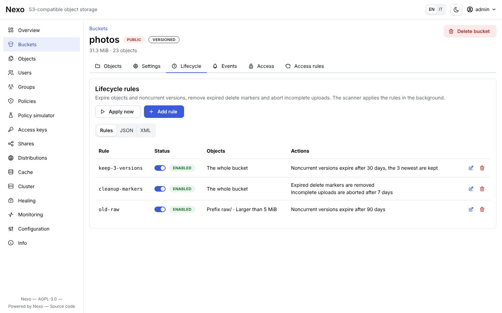
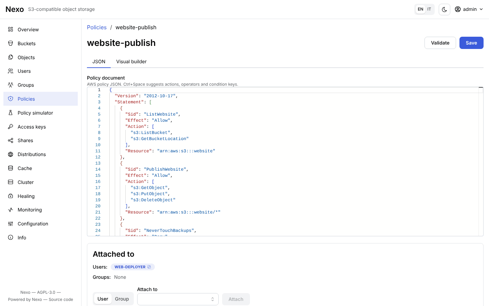
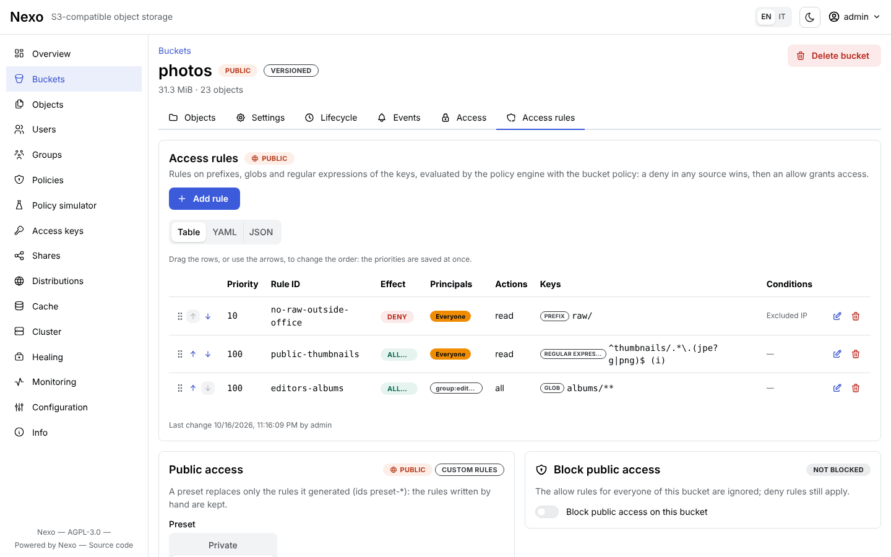
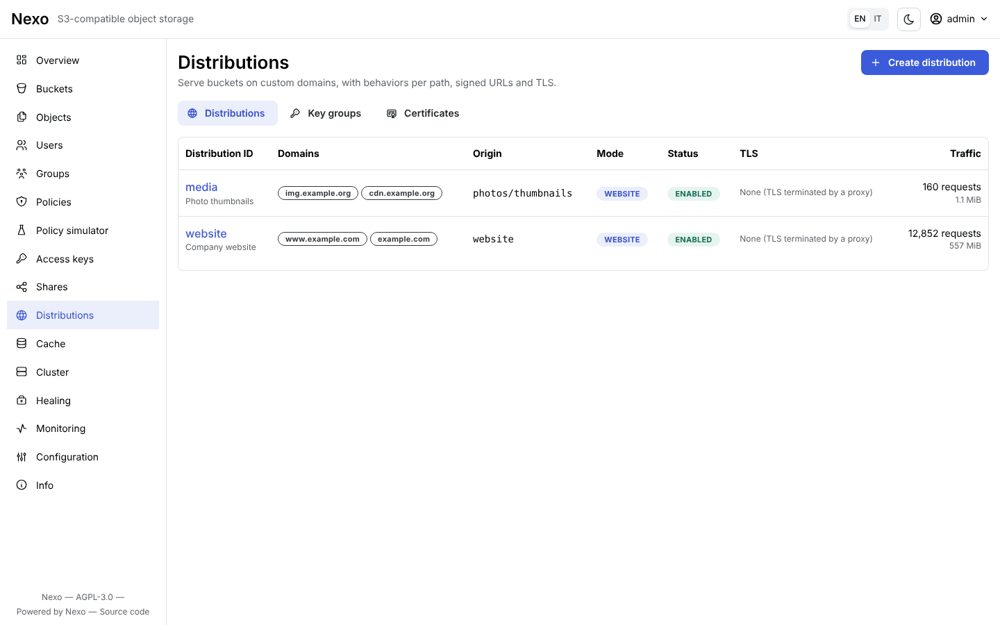
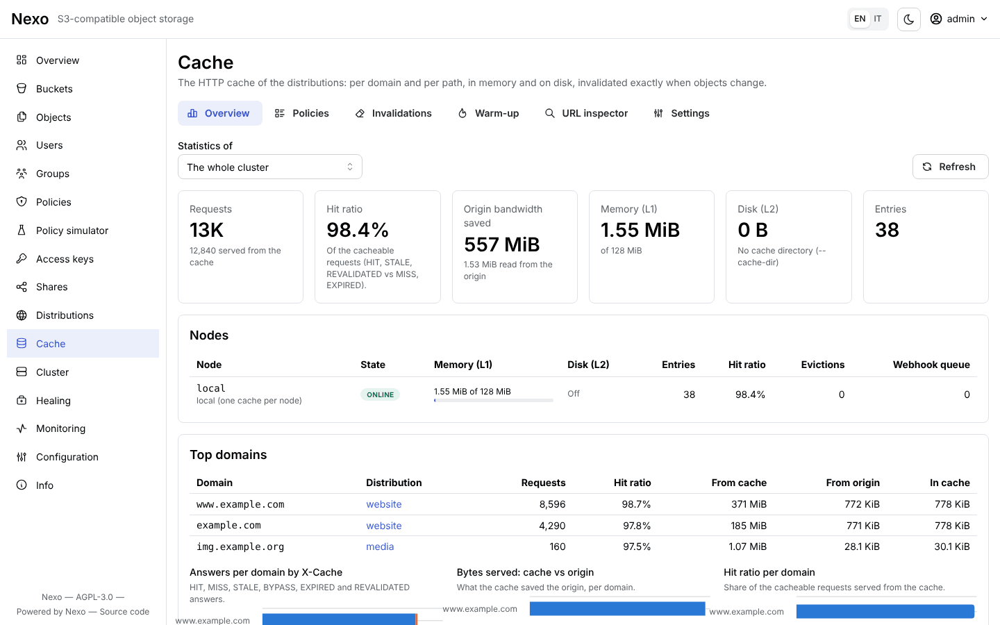
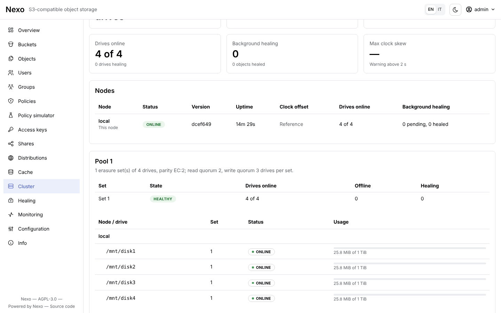
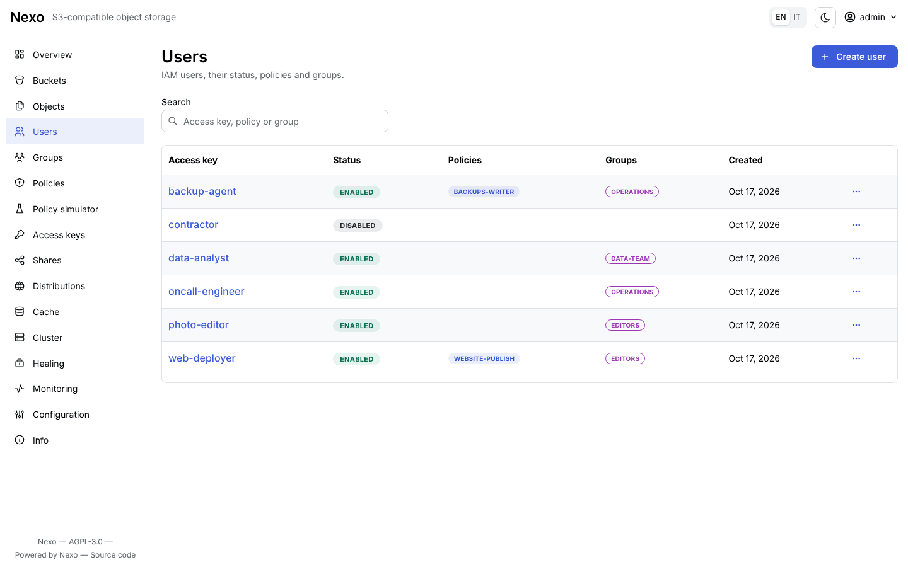
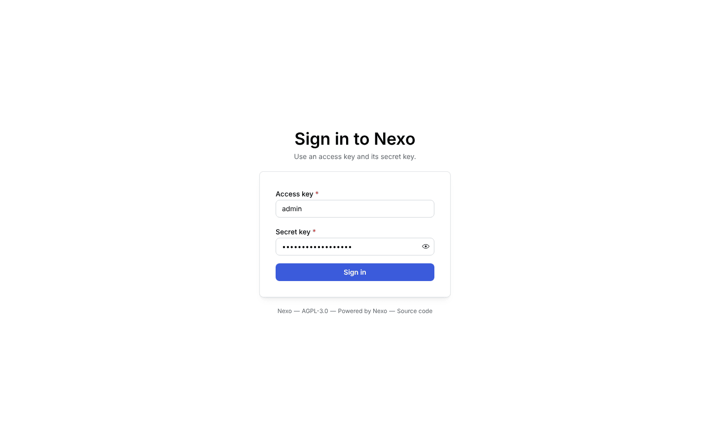

# Nexo

[English](README.md) | **Italiano**

[](https://github.com/R3n3r0/Nexo/actions/workflows/ci.yml)
[](https://r3n3r0.github.io/Nexo/)
[](https://hub.docker.com/r/paolor/nexo)
[](LICENSE)

**Nexo** è un object storage compatibile con l'API **Amazon S3**, scritto in Go. Un solo binario
(`nexo`) contiene il server S3, l'Admin API e la console web; `nexoctl` è la CLI per i dati e
l'amministrazione. Lo stesso binario gira su un disco, su più dischi con erasure coding e in cluster
multi-nodo, senza database di metadati esterni.

- **API S3**: SigV4, bucket, oggetti, multipart, versioning, Object Lock, lifecycle, notifiche, CORS,
  checksum, cifratura SSE-S3/SSE-KMS/SSE-C, URL presigned e POST policy; superati tutti i 451 test applicabili
  della suite Ceph `s3-tests` e i 638 delle suite SDK di MinIO `mint`, in singolo disco, più dischi e cluster.
- **Durabilità**: erasure coding Reed-Solomon con parità configurabile, protezione dal bitrot, healing
  automatico, sostituzione dei dischi a caldo, espansione con nuovi pool.
- **Sicurezza**: utenti, gruppi e policy IAM, access key con scadenza, STS, regole di accesso con glob e
  regex, link di condivisione revocabili, TLS con ricarica a caldo, mTLS tra i nodi, KMS integrato o KES,
  audit log.
- **Distribuzioni**: un bucket servito su domini personalizzati in stile CloudFront, con certificati ACME,
  URL firmati, cache in memoria e su disco con invalidazione automatica.
- **Operatività**: console web, metriche Prometheus con dashboard Grafana e alert pronti, trace e log in
  tempo reale, OpenTelemetry, pacchetti deb/rpm, Homebrew, immagini Docker, Helm chart, unit systemd.

## Screenshot

<picture>
  <source media="(prefers-color-scheme: dark)" srcset="docs/images/screenshots/overview-dark.png">
  
</picture>

<sub>La panoramica della console web (in modalità scura se il browser la preferisce). Le immagini sono
prese da un deployment dimostrativo con `make screenshots`; la console è mostrata in inglese e la capacità dei dischi è indicativa (4 × 1 TiB).</sub>

<table>
  <tr>
    <td width="50%" valign="top">
      <a href="docs/images/screenshots/object-browser.png"></a><br>
      <sub><b>Browser degli oggetti</b>: cartelle, upload, versioni, anteprime e link di condivisione</sub>
    </td>
    <td width="50%" valign="top">
      <a href="docs/images/screenshots/bucket-lifecycle.png"></a><br>
      <sub><b>Lifecycle del bucket</b>: scadenza, versioni non correnti e upload incompleti</sub>
    </td>
  </tr>
  <tr>
    <td width="50%" valign="top">
      <a href="docs/images/screenshots/policy-editor.png"></a><br>
      <sub><b>Editor delle policy IAM</b>: JSON delle policy AWS con completamento, validazione e builder visuale</sub>
    </td>
    <td width="50%" valign="top">
      <a href="docs/images/screenshots/access-rules.png"></a><br>
      <sub><b>Regole di accesso</b>: consenti e nega per prefisso, glob o regex, con condizioni</sub>
    </td>
  </tr>
  <tr>
    <td width="50%" valign="top">
      <a href="docs/images/screenshots/distributions.png"></a><br>
      <sub><b>Distribuzioni</b>: bucket serviti su domini personalizzati, con TLS e traffico</sub>
    </td>
    <td width="50%" valign="top">
      <a href="docs/images/screenshots/cache.png"></a><br>
      <sub><b>Cache delle distribuzioni</b>: hit ratio, banda risparmiata e domini più richiesti</sub>
    </td>
  </tr>
  <tr>
    <td width="50%" valign="top">
      <a href="docs/images/screenshots/monitoring.png"></a><br>
      <sub><b>Monitoraggio</b>: richieste, errori, latenza e banda di ogni nodo</sub>
    </td>
    <td width="50%" valign="top">
      <a href="docs/images/screenshots/cluster.png"></a><br>
      <sub><b>Cluster</b>: pool, erasure set, nodi e dischi a colpo d'occhio</sub>
    </td>
  </tr>
  <tr>
    <td width="50%" valign="top">
      <a href="docs/images/screenshots/users.png"></a><br>
      <sub><b>Utenti</b>: utenti IAM con le loro policy e i gruppi</sub>
    </td>
    <td width="50%" valign="top">
      <a href="docs/images/screenshots/login.png"></a><br>
      <sub><b>Accesso</b>: la console usa le stesse access key dell'API S3</sub>
    </td>
  </tr>
</table>

## Avvio rapido

Con Docker:

```bash
docker run -d --name nexo -p 9000:9000 -p 9001:9001 \
  -e NEXO_ROOT_USER=admin -e NEXO_ROOT_PASSWORD=supersegreta \
  -v nexo-data:/data paolor/nexo:latest server /data
```

Le immagini sono su Docker Hub: [`paolor/nexo`](https://hub.docker.com/r/paolor/nexo) (server e CLI) e
[`paolor/nexoctl`](https://hub.docker.com/r/paolor/nexoctl) (solo CLI).

Con il binario ([release](https://github.com/R3n3r0/Nexo/releases) o `make build`):

```bash
export NEXO_ROOT_USER=admin NEXO_ROOT_PASSWORD=supersegreta
nexo server ~/nexo-data          # percorso assoluto; più dischi: nexo server /mnt/disk{1...4}
```

Poi apri la console su <http://localhost:9001> (utente `admin`, password `supersegreta`) oppure usa la CLI:

```bash
nexoctl alias set local http://localhost:9000 admin supersegreta
nexoctl mb local/foto
nexoctl cp hello.txt local/foto/
nexoctl share download --expire 2h local/foto/hello.txt     # link revocabile
```

Qualsiasi client S3 funziona con l'endpoint `http://localhost:9000` e le stesse credenziali, per esempio
`aws --endpoint-url http://localhost:9000 s3 ls`.

## Documentazione

**📖 Sito della documentazione: <https://r3n3r0.github.io/Nexo/it/>** (inglese: <https://r3n3r0.github.io/Nexo/>),
con ricerca, il riferimento della CLI e l'Admin API.

Le stesse pagine sono in [`docs/user`](docs/user/README.it.md), in inglese con la traduzione italiana accanto a
ogni pagina (`<pagina>.it.md`; anche su <https://github.com/R3n3r0/Nexo/tree/main/docs/user>, per chi legge
questo file da un archivio di release):

| | |
|---|---|
| [Quickstart](docs/user/quickstart.it.md) | il percorso completo in cinque minuti |
| [Installazione](docs/user/installation.it.md) | binari, deb/rpm, Homebrew, Docker, Compose, Helm, systemd |
| [Modalità di deployment](docs/user/deployment-modes.it.md) | singolo disco, più dischi, cluster, dimensionamento |
| [Configurazione](docs/user/configuration.it.md) | flag, variabili d'ambiente, configurazione dinamica |
| [Guida operativa](docs/user/operations/monitoring.it.md) | monitoraggio, healing, aggiornamenti, backup, risoluzione dei problemi |
| [Sicurezza](docs/user/security/users-policies.it.md) | policy, condivisione, regole di accesso, TLS, KMS |
| [Distribuzioni e cache](docs/user/distributions/README.it.md) | domini personalizzati, con un [tutorial](docs/user/distributions/tutorial-static-site.it.md) completo |
| [Riferimenti](docs/user/reference/cli.it.md) | CLI, [Admin API](docs/user/reference/admin-api.it.md), [compatibilità S3](docs/user/reference/s3-compatibility.it.md) |

`make docs-site` la pubblica come sito statico con MkDocs (in `bin/site`, in inglese e in italiano sotto `/it/`).

### Documenti di progetto

| # | Documento | Contenuto |
|---|-----------|-----------|
| 1 | [Architettura](docs/01-architecture.md) | Componenti, layout del repository, stack, scelte tecniche |
| 2 | [Funzionalità](docs/02-features.md) | Catalogo delle funzionalità di server, dashboard e CLI, differenze rispetto ad S3 |
| 3 | [Cluster](docs/03-cluster.md) | Topologia, erasure coding, quorum, lock distribuiti, healing, espansione |
| 4 | [API](docs/04-api.md) | API S3 supportate, Admin API, Internode RPC |
| 5 | [Roadmap e task](docs/05-roadmap.md) | Milestone, task con ID, dipendenze e criteri di accettazione, stato |
| 6 | [Piano di test](docs/06-test-plan.md) | Strategia e casi di test per server, CLI, dashboard e cluster |
| 7 | [Sicurezza e operatività](docs/07-security-operations.md) | Threat model, TLS, KMS, osservabilità |
| 8 | [Modalità e rilascio](docs/08-deployment-modes.md) | Modalità di deployment, packaging e processo di rilascio |
| 9 | [Presigned, policy e condivisione](docs/09-presigned-policy-sharing.md) | URL presigned, POST policy, policy, share link revocabili |
| 10 | [Accessi, domini e distribuzioni](docs/10-domains-access-distributions.md) | Regole di accesso, domini, distribuzioni dietro proxy |
| 11 | [Cache per dominio](docs/11-domain-cache.md) | Cache memoria/disco, policy per livello, invalidazione, cache in cluster |
| 12 | [Architettura a servizi](docs/12-service-architecture.md) | Convenzione vincolante per servizi, rotte e composizione in `internal/app` |

Le modifiche di ogni release sono nel [CHANGELOG](CHANGELOG.md); la copertura dei test di ogni funzionalità del
catalogo è nella [matrice di tracciabilità](test/TRACEABILITY.md).

## Sviluppo

Servono Go (versione in `go.mod`) e, per la console, Node.js.

| Comando | Cosa esegue |
|---------|-------------|
| `make build` | console React e binari `bin/nexo` e `bin/nexoctl` con la console inclusa (`make build-go`: solo Go) |
| `make test` / `make test-race` | test Go (unit e integrazione in-process nelle tre modalità) |
| `make test-integration` | suite di integrazione S3/IAM/presigned in tutte le modalità, test lenti inclusi |
| `make test-cluster` | test del cluster con 4 processi `bin/nexo` reali (kill, pausa, riavvio) |
| `make test-s3compat` | suite di compatibilità Ceph `s3-tests` |
| `make lint` / `make web-lint` / `make web-test` / `make e2e` | lint Go, lint e test della console, Playwright |
| `make run-cluster` | cluster locale di 4 processi con S3 su `127.0.0.1:9101`, `9103`, `9105`, `9107` e console sulla porta successiva (Linux) |
| `make docs` / `make docs-check` | riferimento della CLI in `docs/user/cli` |
| `make traceability` / `make traceability-check` | matrice funzionalità → test in `test/TRACEABILITY.md` |
| `make security` | govulncheck, gosec e `npm audit` |
| `make zap-scan` | scansione attiva autenticata OWASP ZAP dell'Admin API da `api/openapi.yaml` contro `bin/nexo` (richiede Java; [test/security/zap-api-scan.sh](test/security/zap-api-scan.sh)) |
| `make screenshots` | rigenera gli screenshot della console in `docs/images/screenshots` da un deployment dimostrativo popolato (Playwright; [scripts/screenshots](scripts/screenshots/run.sh)) |
| `make dco` | il controllo del sign-off delle pull request sui commit del branch ([CONTRIBUTING.md](CONTRIBUTING.md)) |
| `make help` | tutti i target |

Il codice segue la convenzione di [docs/12](docs/12-service-architecture.md): ogni servizio ha
un'interfaccia e un'implementazione non esportata, la composizione avviene solo in `internal/app`.

## Licenza

Nexo è software libero distribuito con la licenza [GNU Affero General Public License v3.0 only](LICENSE)
(`AGPL-3.0-only`): se lo modifichi e permetti agli utenti di interagirci attraverso una rete, devi offrire loro il
codice sorgente della tua versione. Il file [NOTICE](NOTICE) aggiunge condizioni di attribuzione (sezione 7(b)
dell'AGPL): conservalo, e conserva "Powered by Nexo (https://github.com/R3n3r0/Nexo)" nelle note legali
dell'interfaccia utente. Le organizzazioni che non possono rispettare l'AGPL possono acquistare una
[licenza commerciale](COMMERCIAL-LICENSE.md) dal titolare del copyright; i contributi sono accettati alle
condizioni di [CONTRIBUTING.md](CONTRIBUTING.md). Archivi, pacchetti deb/rpm, immagini dei container e Helm chart
contengono `LICENSE` (e `NOTICE` negli archivi e nei pacchetti). In caso di dubbio fa fede il testo inglese di
questa sezione nel [README](README.md#license) e il testo della licenza.
