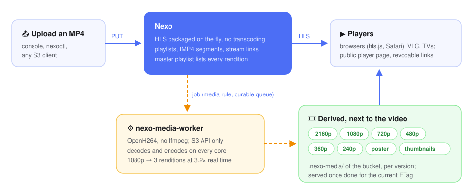
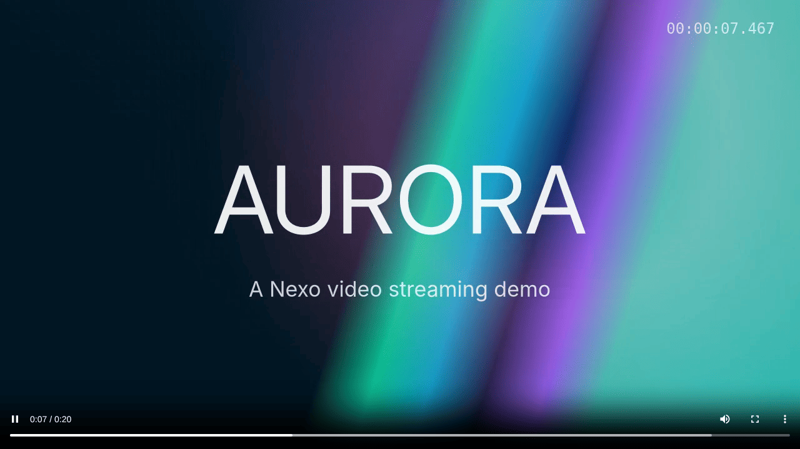
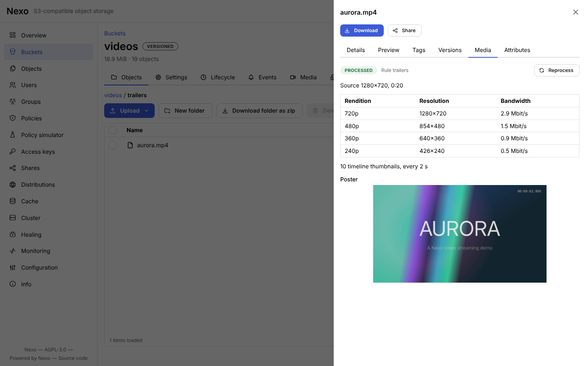
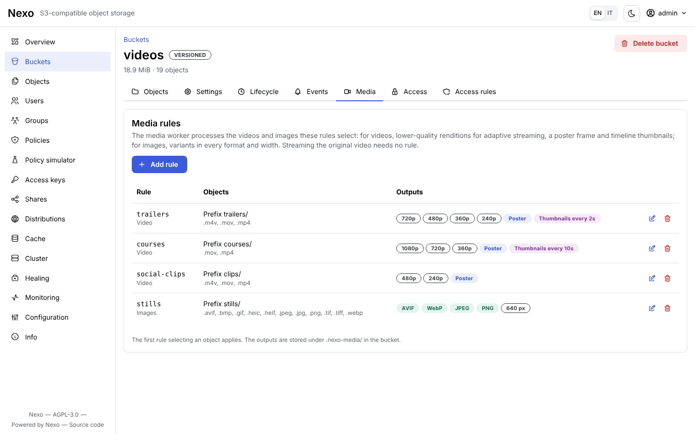
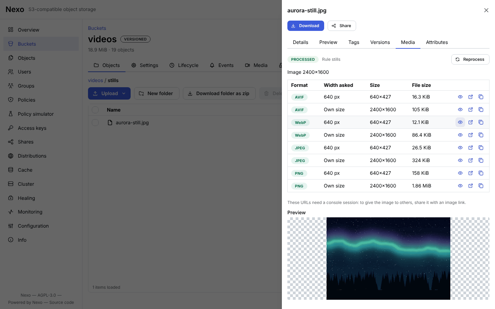
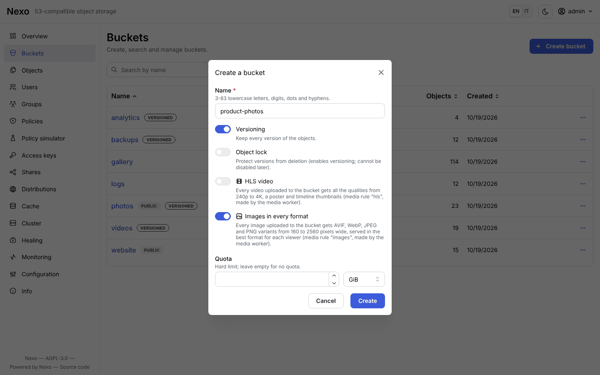

<p align="center">
  
</p>

<h1 align="center">Nexo</h1>

<p align="center">
  <b>Self-hosted, S3-compatible object storage in Go, with video streaming and responsive images built in.</b><br>
  One binary: S3 server, Admin API and web console. From one drive to a multi-node cluster.
</p>

<p align="center">
  <a href="https://github.com/R3n3r0/Nexo/actions/workflows/ci.yml"></a>
  <a href="https://r3n3r0.github.io/Nexo/"></a>
  <a href="https://hub.docker.com/r/paolor/nexo"></a>
  <a href="LICENSE"></a>
  
  
</p>

<p align="center">
  <a href="#-quick-start"><b>Quick start</b></a> ·
  <a href="#-features"><b>Features</b></a> ·
  <a href="#-video-built-in"><b>Video</b></a> ·
  <a href="#%EF%B8%8F-images-in-every-format"><b>Images</b></a> ·
  <a href="#-screenshots"><b>Screenshots</b></a> ·
  <a href="https://r3n3r0.github.io/Nexo/"><b>Documentation</b></a> ·
  <a href="README.it.md"><b>Italiano</b></a>
</p>

<p align="center">
  
</p>

<p align="center"><sub>Sign in, a versioned bucket, an upload, a preview and a share link in the web console (recorded with <code>make demo-gif</code>).</sub></p>

## ✨ Why Nexo

- **One binary, no moving parts.** `nexo` is the S3 server, the Admin API and the web console; there is no
  external metadata database. The same binary runs on one drive, on several drives with erasure coding, or as a
  cluster of nodes.
- **Really S3.** It passes all 451 applicable tests of Ceph's `s3-tests` and the 638 of MinIO's `mint` SDK
  suites, on one drive, several drives and in a cluster: your SDKs, `aws`, `rclone` and backup tools just work.
- **Your videos play the moment they land.** An uploaded MP4 streams as HLS straight away, and a media worker
  can add every quality from 240p to 4K, a poster and seek-bar thumbnails, with no ffmpeg anywhere.
- **Every photo in the format and size each screen needs.** The same worker turns every uploaded image into
  AVIF, WebP, JPEG and PNG at every width, and one URL serves the most compact one the browser accepts, on the
  S3 endpoint or on your own domain.
- **Built for operators.** A console for everything, Prometheus metrics with a ready-made Grafana dashboard,
  live traces and logs, and packages for every platform.

**Coming from MinIO?** Follow the [migration guide](https://r3n3r0.github.io/Nexo/migrate-from-minio/) (every
version, policies and users, verified with `nexoctl diff`). **Choosing a store?** See
[how Nexo compares](https://r3n3r0.github.io/Nexo/comparison/) with MinIO, SeaweedFS, Garage and Ceph RGW,
including where another project fits better.

## 🚀 Quick start

<table>
<tr>
<td width="50%" valign="top">

**Docker**

```bash
docker run -d --name nexo -p 9000:9000 -p 9001:9001 \
  -e NEXO_ROOT_USER=admin \
  -e NEXO_ROOT_PASSWORD=supersecret \
  -v nexo-data:/data paolor/nexo:latest server /data
```

</td>
<td width="50%" valign="top">

**Binary** ([releases](https://github.com/R3n3r0/Nexo/releases) or `make build`)

```bash
export NEXO_ROOT_USER=admin NEXO_ROOT_PASSWORD=supersecret
nexo server ~/nexo-data
# several drives: nexo server /mnt/disk{1...4}
```

</td>
</tr>
</table>

Open the console at <http://localhost:9001> (user `admin`, password `supersecret`), or use the CLI:

```bash
nexoctl alias set local http://localhost:9000 admin supersecret
nexoctl mb local/photos
nexoctl cp hello.txt local/photos/
nexoctl share download --expire 2h local/photos/hello.txt     # a revocable link
```

Any S3 client works with the endpoint `http://localhost:9000` and the same credentials, for example
`aws --endpoint-url http://localhost:9000 s3 ls`. The images are on Docker Hub:
[`paolor/nexo`](https://hub.docker.com/r/paolor/nexo) (server and CLI) and
[`paolor/nexoctl`](https://hub.docker.com/r/paolor/nexoctl) (CLI only).

## 🧩 Features

<table>
<tr>
<td width="50%" valign="top">

### 🪣 S3 API
SigV4, buckets, objects, multipart, versioning, Object Lock, lifecycle, notifications, CORS, checksums,
SSE-S3 / SSE-KMS / SSE-C encryption, presigned URLs and POST policies.

</td>
<td width="50%" valign="top">

### 🛡️ Durability
Reed-Solomon erasure coding with configurable parity, bitrot protection, automatic healing, hot drive
replacement, expansion with new pools.

</td>
</tr>
<tr>
<td width="50%" valign="top">

### 🔐 Security
IAM users, groups and policies, access keys with expiry, STS, access rules with glob and regex, revocable
share links, TLS with hot reload, mTLS between nodes, built-in KMS or KES, audit log.

</td>
<td width="50%" valign="top">

### 🎬 Video and images
MP4 videos stream as HLS packaged on the fly, with revocable stream links and a public player page. The media
worker adds renditions, posters and thumbnails ([video](#-video-built-in)), and every image in AVIF, WebP,
JPEG and PNG at every width ([images](#%EF%B8%8F-images-in-every-format)).

</td>
</tr>
<tr>
<td width="50%" valign="top">

### 🌍 Distributions
A bucket served on your own domains, CloudFront style: ACME certificates, signed URLs, in-memory and on-disk
cache with automatic invalidation.

</td>
<td width="50%" valign="top">

### 📈 Operations
Web console, Prometheus metrics with Grafana dashboard and alerts, live trace and logs, OpenTelemetry,
deb/rpm, Homebrew, Docker images, Helm chart, systemd unit.

</td>
</tr>
</table>

## 🎬 Video, built in

Upload an MP4 and it plays at once, in any browser and any HLS player: Nexo packages the stream on the fly from
the file you stored, with no transcoding and nothing to prepare. Share it with a revocable stream link that opens
a ready-made player page.

Create the bucket with the **HLS video** option (or add a **media rule** to an existing one) and
`nexo-media-worker` derives more from every video it selects: lower
qualities for slow networks (240p to 2160p, offered by the same playlist), a poster and the thumbnails of the
seek bar. The worker is a separate Go program built on Cisco's OpenH264, **no ffmpeg**, that works through the S3
API with a least-privilege policy and never loses a job.

<p align="center">
  
</p>

<table>
  <tr>
    <td width="50%" valign="top">
      <a href="docs/images/screenshots/video-player.png"></a><br>
      <sub><b>Player</b>: HLS in any browser, with the quality picked for the network</sub>
    </td>
    <td width="50%" valign="top">
      <a href="docs/images/screenshots/media-panel.png"></a><br>
      <sub><b>Media panel</b>: poster, timeline thumbnails and renditions of a video</sub>
    </td>
  </tr>
  <tr>
    <td width="50%" valign="top">
      <a href="docs/images/screenshots/media-rules.png"></a><br>
      <sub><b>Media rules</b>: which videos and images of a bucket get which outputs</sub>
    </td>
    <td width="50%" valign="top">

```bash
# stream any MP4 through a revocable link
nexoctl share download --stream --expire 7d \
  local/videos/talk.mp4

# a video bucket: every quality, poster, thumbnails
nexoctl mb --with-hls local/videos
nexoctl cp intro.mp4 local/videos/
nexoctl media status local/videos/intro.mp4
```

</td>
  </tr>
</table>

| Job on a 20 s 1080p video (4 vCPU Xeon 2.1 GHz) | Speed |
|---|---|
| 720p + 360p + 240p renditions | **3.2× real time** (a 10-minute video in about 3 minutes) |
| one rendition | 4–4.5× real time |
| thumbnails, one per second | 74× real time |
| poster | 44 ms |

Every job uses all the cores: the video is split at its keyframes and each part is decoded and encoded on its
own core, with the same result byte for byte. Details: [video streaming](docs/user/video-streaming.md),
[media worker](docs/user/media-worker.md), [benchmarks](docs/bench/media.md).

## 🖼️ Images in every format

Upload a photo once and every screen gets the right file. In an image bucket `nexo-media-worker` turns each
picture into **AVIF, WebP, JPEG and PNG** at its own size and at every width from 160 to 2560 pixels, and a
single URL serves the narrowest variant wide enough in the most compact format the client accepts: AVIF to
recent browsers, WebP to the others, JPEG to everyone else. Pure Go, nothing like libvips or ImageMagick to
install.

<table>
  <tr>
    <td width="50%" valign="top">
      <a href="docs/images/screenshots/image-variants.png"></a><br>
      <sub><b>Variants</b>: every format and width of a photo, with their size and a preview</sub>
    </td>
    <td width="50%" valign="top">
      <a href="docs/images/screenshots/create-bucket.png"></a><br>
      <sub><b>Image buckets</b>: one switch when the bucket is created, or an image rule later</sub>
    </td>
  </tr>
</table>

```bash
# an image bucket: every photo in AVIF, WebP, JPEG and PNG, at every width
nexoctl mb --with-images local/photos
nexoctl cp beach.jpg local/photos/
nexoctl media status local/photos/beach.jpg

# 640 pixels wide, in the best format the client accepts (a public bucket here:
# otherwise sign the URL or make a share link with nexoctl share download --image)
curl -H 'Accept: image/avif,image/webp' -o beach.avif \
  'http://localhost:9000/nexo/media/v1/photos/image/beach.jpg?w=640'
```

```html
<!-- the browser picks the width, Nexo picks the format -->

```

**On your own domain, the same URL serves AVIF, WebP or JPEG.** A [distribution](docs/user/distributions/README.md)
of an image bucket answers `https://cdn.example.com/photos/beach.jpg` with the best format for the `Accept`
header of each browser; `?w=640` asks for a width, `?format=webp` for a format and `?format=original` for the
file you uploaded.

| | |
|---|---|
| Formats | AVIF, WebP, JPEG, PNG (all of them, or those of the rule) |
| Widths | the image at its own size and 160, 320, 640, 1280, 1920, 2560 px; never enlarged |
| Sources | JPEG, PNG, GIF, WebP, AVIF, HEIC (iPhone photos), TIFF, BMP, recognized by their content |
| Variants | upright (EXIF orientation applied), no metadata (no EXIF, GPS or camera data), transparency kept |

| Job on a 12 MP photo (4 vCPU Xeon 2.1 GHz) | Time |
|---|---|
| 28 variants: 4 formats × its own size and 6 widths | **11 s** |
| 14 variants, WebP and JPEG only | 3 s |

The variants are encoded in parallel within a memory budget, and decompression bombs are refused before they
are decoded. Details: [media worker](docs/user/media-worker.md#images-every-format-and-width),
[benchmarks](docs/bench/media.md#8-images).

## 📸 Screenshots

<picture>
  <source media="(prefers-color-scheme: dark)" srcset="docs/images/screenshots/overview-dark.png">
  
</picture>

<sub>The overview of the web console (shown in dark mode when your browser prefers it). The images are
taken from a demo deployment with `make screenshots`; drive capacity is shown as 4 × 1 TiB for illustration.</sub>

<table>
  <tr>
    <td width="50%" valign="top">
      <a href="docs/images/screenshots/object-browser.png"></a><br>
      <sub><b>Object browser</b>: folders, uploads, versions, previews and share links</sub>
    </td>
    <td width="50%" valign="top">
      <a href="docs/images/screenshots/bucket-lifecycle.png"></a><br>
      <sub><b>Bucket lifecycle</b>: expiration, noncurrent versions and incomplete uploads</sub>
    </td>
  </tr>
  <tr>
    <td width="50%" valign="top">
      <a href="docs/images/screenshots/policy-editor.png"></a><br>
      <sub><b>IAM policy editor</b>: AWS policy JSON with completion, validation and a visual builder</sub>
    </td>
    <td width="50%" valign="top">
      <a href="docs/images/screenshots/access-rules.png"></a><br>
      <sub><b>Access rules</b>: allow and deny by prefix, glob or regex, with conditions</sub>
    </td>
  </tr>
  <tr>
    <td width="50%" valign="top">
      <a href="docs/images/screenshots/distributions.png"></a><br>
      <sub><b>Distributions</b>: buckets served on custom domains, with TLS and traffic</sub>
    </td>
    <td width="50%" valign="top">
      <a href="docs/images/screenshots/cache.png"></a><br>
      <sub><b>Distribution cache</b>: hit ratio, bandwidth saved and top domains</sub>
    </td>
  </tr>
  <tr>
    <td width="50%" valign="top">
      <a href="docs/images/screenshots/monitoring.png"></a><br>
      <sub><b>Monitoring</b>: requests, errors, latency and bandwidth of every node</sub>
    </td>
    <td width="50%" valign="top">
      <a href="docs/images/screenshots/cluster.png"></a><br>
      <sub><b>Cluster</b>: pools, erasure sets, nodes and drives at a glance</sub>
    </td>
  </tr>
  <tr>
    <td width="50%" valign="top">
      <a href="docs/images/screenshots/users.png"></a><br>
      <sub><b>Users</b>: IAM users with their policies and groups</sub>
    </td>
    <td width="50%" valign="top">
      <a href="docs/images/screenshots/login.png"></a><br>
      <sub><b>Sign in</b>: the console uses the same access keys as the S3 API</sub>
    </td>
  </tr>
</table>

## ⚡ Performance

Measured on a 4 vCPU Xeon virtual machine, with the method and the machine described in
[docs/bench](docs/bench/README.md) (`make bench` and `make bench-media` measure your own hardware and save its
description with the results):

| warp, same VM | 1 drive | 4 drives, EC 2+2 | cluster, 4 processes × 2 drives, EC 4+4 |
|---|---|---|---|
| PUT 64 MiB objects | 727 MiB/s | 384 MiB/s | 296 MiB/s |
| GET 64 MiB objects | 3.8 GiB/s | 2.9 GiB/s | 1.4 GiB/s |
| Mixed workload | 4439 op/s | 2498 op/s | 327 op/s |
| LIST | 61 680 keys/s | 18 604 keys/s | 7093 keys/s |

The cluster row runs four nodes on the same 4 vCPU machine: a real cluster spreads them over machines and
networks. Video and image jobs are in the sections [video](#-video-built-in) and
[images](#%EF%B8%8F-images-in-every-format).

## 📚 Documentation

**📖 Documentation site: <https://r3n3r0.github.io/Nexo/>** (Italian: <https://r3n3r0.github.io/Nexo/it/>), with
search, the CLI reference and the Admin API.

The same pages are in [`docs/user`](docs/user/README.md), in English with an Italian translation next to every
page (`<page>.it.md`; also at <https://github.com/R3n3r0/Nexo/tree/main/docs/user>, for those reading this file
from a release archive):

| | |
|---|---|
| 🏁 [Quickstart](docs/user/quickstart.md) | the complete walkthrough in five minutes |
| 📦 [Installation](docs/user/installation.md) | binaries, deb/rpm, Homebrew, Docker, Compose, Helm, systemd |
| 🗄️ [Deployment modes](docs/user/deployment-modes.md) | single drive, multiple drives, cluster, sizing |
| ⚙️ [Configuration](docs/user/configuration.md) | flags, environment variables, dynamic configuration |
| 🩺 [Operations guide](docs/user/operations/monitoring.md) | monitoring, healing, upgrades, backup, troubleshooting |
| 🔐 [Security](docs/user/security/users-policies.md) | policies, sharing, access rules, TLS, KMS |
| 🌍 [Distributions and cache](docs/user/distributions/README.md) | custom domains, with a complete [tutorial](docs/user/distributions/tutorial-static-site.md) |
| 🎬 [Video and images](docs/user/video-streaming.md) | HLS streaming, stream links and the [media worker](docs/user/media-worker.md): renditions, posters, thumbnails and [images in every format](docs/user/media-worker.md#images-every-format-and-width) |
| 📘 [Reference](docs/user/reference/cli.md) | CLI, [Admin API](docs/user/reference/admin-api.md), [S3 compatibility](docs/user/reference/s3-compatibility.md) |

`make docs-site` publishes it as a static site with MkDocs (in `bin/site`, in English and in Italian under `/it/`).

<details>
<summary><b>Project documents</b> (architecture, design, roadmap, test plan)</summary>

| # | Document | Contents |
|---|----------|----------|
| 1 | [Architecture](docs/01-architecture.md) | Components, repository layout, stack, technical choices |
| 2 | [Features](docs/02-features.md) | Catalog of the server, dashboard and CLI features, differences from S3 |
| 3 | [Cluster](docs/03-cluster.md) | Topology, erasure coding, quorum, distributed locks, healing, expansion |
| 4 | [API](docs/04-api.md) | Supported S3 APIs, Admin API, internode RPC |
| 5 | [Roadmap and tasks](docs/05-roadmap.md) | Milestones, tasks with IDs, dependencies and acceptance criteria, status |
| 6 | [Test plan](docs/06-test-plan.md) | Strategy and test cases for server, CLI, dashboard and cluster |
| 7 | [Security and operations](docs/07-security-operations.md) | Threat model, TLS, KMS, observability |
| 8 | [Modes and release](docs/08-deployment-modes.md) | Deployment modes, packaging and release process |
| 9 | [Presigned URLs, policies and sharing](docs/09-presigned-policy-sharing.md) | Presigned URLs, POST policies, policies, revocable share links |
| 10 | [Access, domains and distributions](docs/10-domains-access-distributions.md) | Access rules, domains, distributions behind proxies |
| 11 | [Per-domain cache](docs/11-domain-cache.md) | Memory/disk cache, per-level policies, invalidation, cluster cache |
| 12 | [Service architecture](docs/12-service-architecture.md) | Binding convention for services, routes and composition in `internal/app` |

The changes of every release are in the [CHANGELOG](CHANGELOG.md); the test coverage of every feature in the
catalog is in the [traceability matrix](test/TRACEABILITY.md).

</details>

## 🛠️ Development

You need Go (the version in `go.mod`) and, for the console, Node.js.

<details>
<summary><b>Make targets</b></summary>

| Command | What it runs |
|---------|--------------|
| `make build` | React console and the `bin/nexo` and `bin/nexoctl` binaries with the console embedded (`make build-go`: Go only) |
| `make test` / `make test-race` | Go tests (unit and in-process integration in the three modes) |
| `make test-integration` | S3/IAM/presigned integration suite in every mode, slow tests included |
| `make test-cluster` | cluster tests with 4 real `bin/nexo` processes (kill, pause, restart) |
| `make test-s3compat` | Ceph `s3-tests` compatibility suite |
| `make lint` / `make web-lint` / `make web-test` / `make e2e` | Go lint, console lint and tests, Playwright |
| `make run-cluster` | local cluster of 4 processes with S3 on `127.0.0.1:9101`, `9103`, `9105`, `9107` and the console on the next port (Linux) |
| `make docs` / `make docs-check` | CLI reference in `docs/user/cli` |
| `make traceability` / `make traceability-check` | feature → test matrix in `test/TRACEABILITY.md` |
| `make security` | govulncheck, gosec and `npm audit` |
| `make bench` / `make bench-media` | warp benchmarks of the server in every mode / benchmarks of the video and image pipeline ([docs/bench](docs/bench/README.md)) |
| `make build-media-worker` / `make docker-media-worker` | the `bin/nexo-media-worker` binary / its image |
| `make zap-scan` | authenticated OWASP ZAP active scan of the Admin API from `api/openapi.yaml` against `bin/nexo` (needs Java; [test/security/zap-api-scan.sh](test/security/zap-api-scan.sh)) |
| `make screenshots` | regenerates the console screenshots in `docs/images/screenshots` from a seeded demo deployment (Playwright; [scripts/screenshots](scripts/screenshots/run.sh)) |
| `make dco` | the sign-off check of the pull requests on the commits of the branch ([CONTRIBUTING.md](CONTRIBUTING.md)) |
| `make help` | all the targets |

</details>

The code follows the convention of [docs/12](docs/12-service-architecture.md): every service has
an interface and an unexported implementation, and composition happens only in `internal/app`.
Contributions are welcome: see [CONTRIBUTING.md](CONTRIBUTING.md).

## 📄 License

Nexo is free software licensed under the [GNU Affero General Public License v3.0 only](LICENSE)
(`AGPL-3.0-only`): if you modify it and let users interact with it over a network, you must offer them the
source code of your version. The [NOTICE](NOTICE) file adds attribution terms (AGPL section 7(b)): keep it, and
keep "Powered by Nexo (https://github.com/R3n3r0/Nexo)" in the legal notices of the user interface. Organizations
that cannot comply with the AGPL can buy a [commercial license](COMMERCIAL-LICENSE.md) from the copyright holder;
contributions are accepted under the terms of [CONTRIBUTING.md](CONTRIBUTING.md). Archives, deb/rpm packages,
container images and the Helm chart carry `LICENSE` (and `NOTICE` in archives and packages).
