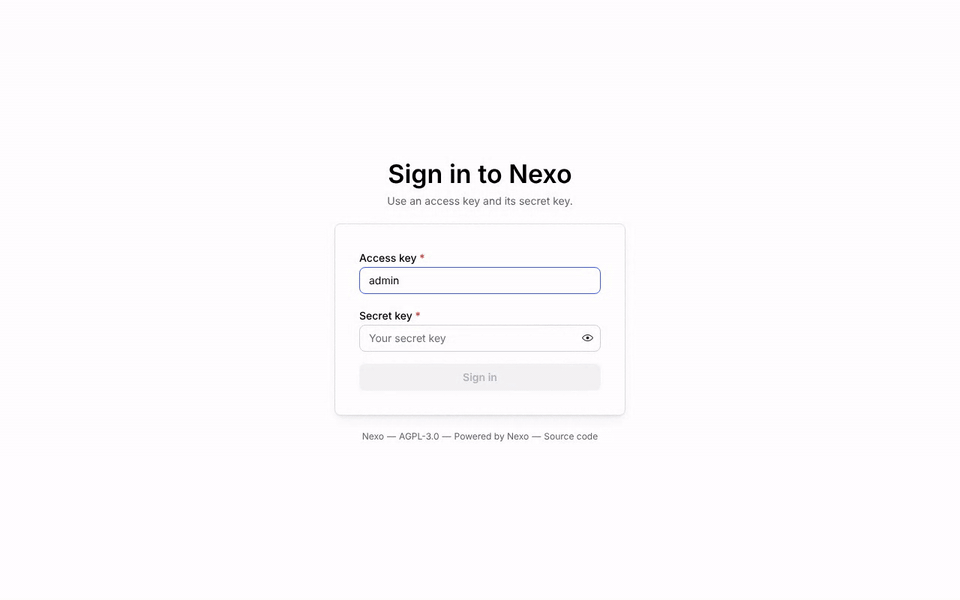

# Nexo

**English** | [Italiano](README.it.md)

[](https://github.com/R3n3r0/Nexo/actions/workflows/ci.yml)
[](https://r3n3r0.github.io/Nexo/)
[](https://hub.docker.com/r/paolor/nexo)
[](LICENSE)

**Nexo** is an object store compatible with the **Amazon S3** API, written in Go. A single binary
(`nexo`) contains the S3 server, the Admin API and the web console; `nexoctl` is the CLI for data and
administration. The same binary runs on one drive, on multiple drives with erasure coding and as a
multi-node cluster, with no external metadata database.

<p align="center">
  
</p>

<sub>Sign in, a versioned bucket, an upload, a preview and a share link in the web console (recorded with `make demo-gif`).</sub>

- **S3 API**: SigV4, buckets, objects, multipart, versioning, Object Lock, lifecycle, notifications, CORS,
  checksums, SSE-S3/SSE-KMS/SSE-C encryption, presigned URLs and POST policies; passes all 451 applicable tests
  of the Ceph `s3-tests` suite and the 638 of MinIO's `mint` SDK suites, on single drive, multiple drives and
  cluster.
- **Durability**: Reed-Solomon erasure coding with configurable parity, bitrot protection, automatic
  healing, hot drive replacement, expansion with new pools.
- **Security**: IAM users, groups and policies, access keys with expiry, STS, access rules with glob and
  regex, revocable share links, TLS with hot reload, mTLS between nodes, built-in KMS or KES,
  audit log.
- **Distributions**: a bucket served on custom domains CloudFront style, with ACME certificates,
  signed URLs, in-memory and on-disk cache with automatic invalidation.
- **Operations**: web console, Prometheus metrics with ready-made Grafana dashboard and alerts, real-time
  trace and logs, OpenTelemetry, deb/rpm packages, Homebrew, Docker images, Helm chart, systemd unit.

**Coming from MinIO?** Follow the [migration guide](https://r3n3r0.github.io/Nexo/migrate-from-minio/) (every version, policies
and users, verified with `nexoctl diff`). **Choosing a store?** See [how Nexo compares](https://r3n3r0.github.io/Nexo/comparison/)
with MinIO, SeaweedFS, Garage and Ceph RGW, including where another project fits better.

## Screenshots

<picture>
  <source media="(prefers-color-scheme: dark)" srcset="docs/images/screenshots/overview-dark.png">
  
</picture>

<sub>The overview of the web console (shown in dark mode when your browser prefers it). The images are
taken from a demo deployment with `make screenshots`; drive capacity is shown as 4 × 1 TiB for illustration.</sub>

<table>
  <tr>
    <td width="50%" valign="top">
      <a href="docs/images/screenshots/object-browser.png"></a><br>
      <sub><b>Object browser</b>: folders, uploads, versions, previews and share links</sub>
    </td>
    <td width="50%" valign="top">
      <a href="docs/images/screenshots/bucket-lifecycle.png"></a><br>
      <sub><b>Bucket lifecycle</b>: expiration, noncurrent versions and incomplete uploads</sub>
    </td>
  </tr>
  <tr>
    <td width="50%" valign="top">
      <a href="docs/images/screenshots/policy-editor.png"></a><br>
      <sub><b>IAM policy editor</b>: AWS policy JSON with completion, validation and a visual builder</sub>
    </td>
    <td width="50%" valign="top">
      <a href="docs/images/screenshots/access-rules.png"></a><br>
      <sub><b>Access rules</b>: allow and deny by prefix, glob or regex, with conditions</sub>
    </td>
  </tr>
  <tr>
    <td width="50%" valign="top">
      <a href="docs/images/screenshots/distributions.png"></a><br>
      <sub><b>Distributions</b>: buckets served on custom domains, with TLS and traffic</sub>
    </td>
    <td width="50%" valign="top">
      <a href="docs/images/screenshots/cache.png"></a><br>
      <sub><b>Distribution cache</b>: hit ratio, bandwidth saved and top domains</sub>
    </td>
  </tr>
  <tr>
    <td width="50%" valign="top">
      <a href="docs/images/screenshots/monitoring.png"></a><br>
      <sub><b>Monitoring</b>: requests, errors, latency and bandwidth of every node</sub>
    </td>
    <td width="50%" valign="top">
      <a href="docs/images/screenshots/cluster.png"></a><br>
      <sub><b>Cluster</b>: pools, erasure sets, nodes and drives at a glance</sub>
    </td>
  </tr>
  <tr>
    <td width="50%" valign="top">
      <a href="docs/images/screenshots/users.png"></a><br>
      <sub><b>Users</b>: IAM users with their policies and groups</sub>
    </td>
    <td width="50%" valign="top">
      <a href="docs/images/screenshots/login.png"></a><br>
      <sub><b>Sign in</b>: the console uses the same access keys as the S3 API</sub>
    </td>
  </tr>
</table>

## Quick start

With Docker:

```bash
docker run -d --name nexo -p 9000:9000 -p 9001:9001 \
  -e NEXO_ROOT_USER=admin -e NEXO_ROOT_PASSWORD=supersecret \
  -v nexo-data:/data paolor/nexo:latest server /data
```

The images are on Docker Hub: [`paolor/nexo`](https://hub.docker.com/r/paolor/nexo) (server and CLI) and
[`paolor/nexoctl`](https://hub.docker.com/r/paolor/nexoctl) (CLI only).

With the binary ([releases](https://github.com/R3n3r0/Nexo/releases) or `make build`):

```bash
export NEXO_ROOT_USER=admin NEXO_ROOT_PASSWORD=supersecret
nexo server ~/nexo-data          # absolute path; multiple drives: nexo server /mnt/disk{1...4}
```

Then open the console at <http://localhost:9001> (user `admin`, password `supersecret`) or use the CLI:

```bash
nexoctl alias set local http://localhost:9000 admin supersecret
nexoctl mb local/photos
nexoctl cp hello.txt local/photos/
nexoctl share download --expire 2h local/photos/hello.txt     # revocable link
```

Any S3 client works with the endpoint `http://localhost:9000` and the same credentials, for example
`aws --endpoint-url http://localhost:9000 s3 ls`.

## Documentation

**📖 Documentation site: <https://r3n3r0.github.io/Nexo/>** (Italian: <https://r3n3r0.github.io/Nexo/it/>), with
search, the CLI reference and the Admin API.

The same pages are in [`docs/user`](docs/user/README.md), in English with an Italian translation next to every
page (`<page>.it.md`; also at <https://github.com/R3n3r0/Nexo/tree/main/docs/user>, for those reading this file
from a release archive):

| | |
|---|---|
| [Quickstart](docs/user/quickstart.md) | the complete walkthrough in five minutes |
| [Installation](docs/user/installation.md) | binaries, deb/rpm, Homebrew, Docker, Compose, Helm, systemd |
| [Deployment modes](docs/user/deployment-modes.md) | single drive, multiple drives, cluster, sizing |
| [Configuration](docs/user/configuration.md) | flags, environment variables, dynamic configuration |
| [Operations guide](docs/user/operations/monitoring.md) | monitoring, healing, upgrades, backup, troubleshooting |
| [Security](docs/user/security/users-policies.md) | policies, sharing, access rules, TLS, KMS |
| [Distributions and cache](docs/user/distributions/README.md) | custom domains, with a complete [tutorial](docs/user/distributions/tutorial-static-site.md) |
| [Reference](docs/user/reference/cli.md) | CLI, [Admin API](docs/user/reference/admin-api.md), [S3 compatibility](docs/user/reference/s3-compatibility.md) |

`make docs-site` publishes it as a static site with MkDocs (in `bin/site`, in English and in Italian under `/it/`).

### Project documents

| # | Document | Contents |
|---|----------|----------|
| 1 | [Architecture](docs/01-architecture.md) | Components, repository layout, stack, technical choices |
| 2 | [Features](docs/02-features.md) | Catalog of the server, dashboard and CLI features, differences from S3 |
| 3 | [Cluster](docs/03-cluster.md) | Topology, erasure coding, quorum, distributed locks, healing, expansion |
| 4 | [API](docs/04-api.md) | Supported S3 APIs, Admin API, internode RPC |
| 5 | [Roadmap and tasks](docs/05-roadmap.md) | Milestones, tasks with IDs, dependencies and acceptance criteria, status |
| 6 | [Test plan](docs/06-test-plan.md) | Strategy and test cases for server, CLI, dashboard and cluster |
| 7 | [Security and operations](docs/07-security-operations.md) | Threat model, TLS, KMS, observability |
| 8 | [Modes and release](docs/08-deployment-modes.md) | Deployment modes, packaging and release process |
| 9 | [Presigned URLs, policies and sharing](docs/09-presigned-policy-sharing.md) | Presigned URLs, POST policies, policies, revocable share links |
| 10 | [Access, domains and distributions](docs/10-domains-access-distributions.md) | Access rules, domains, distributions behind proxies |
| 11 | [Per-domain cache](docs/11-domain-cache.md) | Memory/disk cache, per-level policies, invalidation, cluster cache |
| 12 | [Service architecture](docs/12-service-architecture.md) | Binding convention for services, routes and composition in `internal/app` |

The changes of every release are in the [CHANGELOG](CHANGELOG.md); the test coverage of every feature in the
catalog is in the [traceability matrix](test/TRACEABILITY.md).

## Development

You need Go (the version in `go.mod`) and, for the console, Node.js.

| Command | What it runs |
|---------|--------------|
| `make build` | React console and the `bin/nexo` and `bin/nexoctl` binaries with the console embedded (`make build-go`: Go only) |
| `make test` / `make test-race` | Go tests (unit and in-process integration in the three modes) |
| `make test-integration` | S3/IAM/presigned integration suite in every mode, slow tests included |
| `make test-cluster` | cluster tests with 4 real `bin/nexo` processes (kill, pause, restart) |
| `make test-s3compat` | Ceph `s3-tests` compatibility suite |
| `make lint` / `make web-lint` / `make web-test` / `make e2e` | Go lint, console lint and tests, Playwright |
| `make run-cluster` | local cluster of 4 processes with S3 on `127.0.0.1:9101`, `9103`, `9105`, `9107` and the console on the next port (Linux) |
| `make docs` / `make docs-check` | CLI reference in `docs/user/cli` |
| `make traceability` / `make traceability-check` | feature → test matrix in `test/TRACEABILITY.md` |
| `make security` | govulncheck, gosec and `npm audit` |
| `make zap-scan` | authenticated OWASP ZAP active scan of the Admin API from `api/openapi.yaml` against `bin/nexo` (needs Java; [test/security/zap-api-scan.sh](test/security/zap-api-scan.sh)) |
| `make screenshots` | regenerates the console screenshots in `docs/images/screenshots` from a seeded demo deployment (Playwright; [scripts/screenshots](scripts/screenshots/run.sh)) |
| `make dco` | the sign-off check of the pull requests on the commits of the branch ([CONTRIBUTING.md](CONTRIBUTING.md)) |
| `make help` | all the targets |

The code follows the convention of [docs/12](docs/12-service-architecture.md): every service has
an interface and an unexported implementation, and composition happens only in `internal/app`.

## License

Nexo is free software licensed under the [GNU Affero General Public License v3.0 only](LICENSE)
(`AGPL-3.0-only`): if you modify it and let users interact with it over a network, you must offer them the
source code of your version. The [NOTICE](NOTICE) file adds attribution terms (AGPL section 7(b)): keep it, and
keep "Powered by Nexo (https://github.com/R3n3r0/Nexo)" in the legal notices of the user interface. Organizations
that cannot comply with the AGPL can buy a [commercial license](COMMERCIAL-LICENSE.md) from the copyright holder;
contributions are accepted under the terms of [CONTRIBUTING.md](CONTRIBUTING.md). Archives, deb/rpm packages,
container images and the Helm chart carry `LICENSE` (and `NOTICE` in archives and packages).
