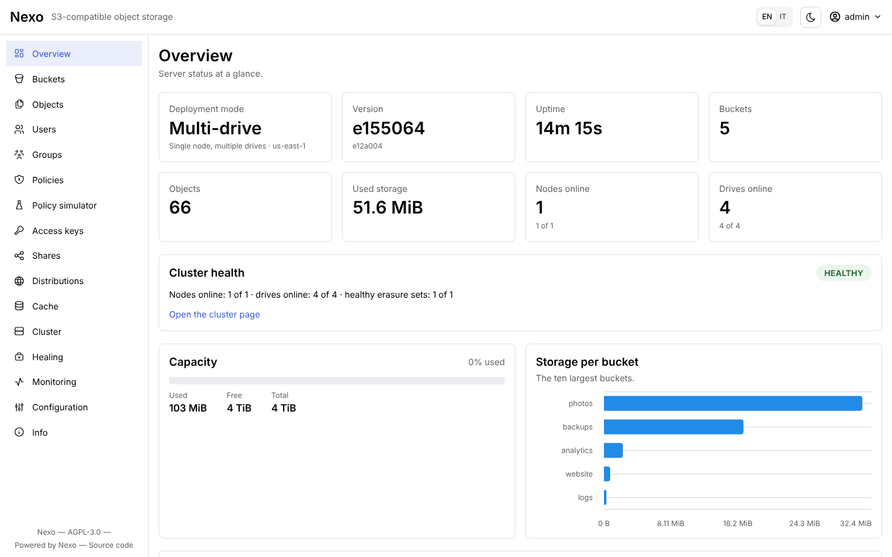
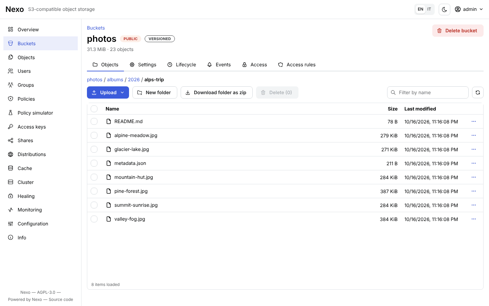
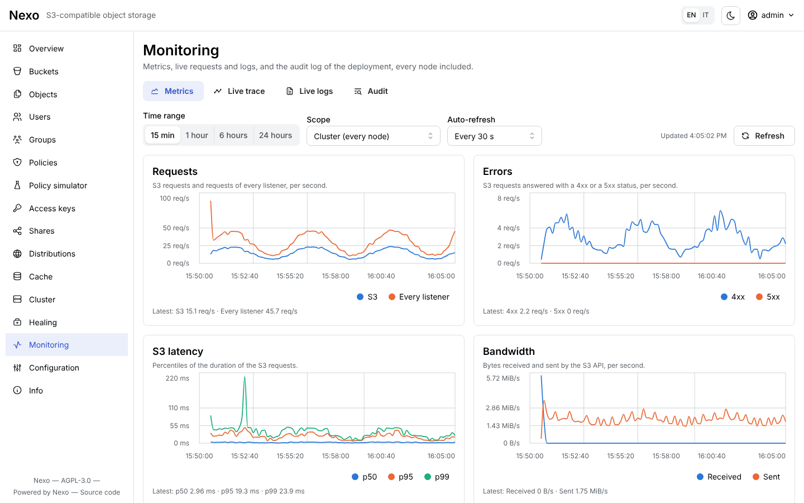

# Documentazione utente di Nexo

**Nexo** è un object storage compatibile con l'API **Amazon S3**: un solo binario (`nexo`) contiene il
server S3, l'Admin API e la console web; `nexoctl` è la CLI per i dati e l'amministrazione. Lo stesso
binario gira su un singolo disco, su più dischi con erasure coding e in cluster multi-nodo.

Questa guida è per chi installa, usa e gestisce Nexo. I documenti di progetto (architettura, roadmap,
piano di test) sono in [`docs/`](https://github.com/R3n3r0/Nexo/tree/main/docs) del repository.

## La console web

La console è servita dallo stesso binario sulla porta della console (9001 di default): bucket e oggetti,
utenti e policy, condivisione, distribuzioni e la loro cache, metriche e stato dei dischi. Si accede con
le stesse access key dell'API S3.

| Browser degli oggetti | Monitoraggio |
|-----------------------|--------------|
|  |  |

## Da dove partire

| Se vuoi… | Leggi |
|----------|-------|
| provare Nexo in 5 minuti | [Quickstart](quickstart.md) |
| installarlo su un server, in Docker o su Kubernetes | [Installazione](installation.md) |
| scegliere tra singolo disco, più dischi e cluster | [Modalità di deployment](deployment-modes.md) |
| conoscere ogni flag e variabile d'ambiente | [Configurazione](configuration.md) |

## Guida operativa

| Argomento | Pagina |
|-----------|--------|
| Health check, metriche Prometheus, Grafana, alert | [Monitoraggio](operations/monitoring.md) |
| Trace e log live, audit log, OpenTelemetry | [Trace, log e audit](operations/trace-log-audit.md) |
| Healing, sostituzione di un disco | [Healing e dischi](operations/healing-disks.md) |
| Aggiornamento rolling, espansione con un nuovo pool | [Aggiornamento ed espansione](operations/upgrade-expansion.md) |
| Backup della configurazione, migrazione tra modalità | [Backup e migrazione](operations/backup-migration.md) |
| Quorum, orologi sfasati, dischi lenti, permessi | [Risoluzione dei problemi](operations/troubleshooting.md) |

## Sicurezza

| Argomento | Pagina |
|-----------|--------|
| Utenti, gruppi, policy (esempi pronti), access key, STS | [Utenti, policy e credenziali](security/users-policies.md) |
| Share link, URL presigned, POST policy, accesso anonimo | [Condivisione e accesso anonimo](security/sharing.md) |
| Regole di accesso con prefix, glob e regex | [Regole di accesso](security/access-rules.md) |
| TLS, certificati, mTLS tra i nodi | [TLS e certificati](security/tls.md) |
| KMS, cifratura lato server, rotazione delle chiavi | [KMS e SSE](security/kms-sse.md) |
| Minacce e mitigazioni | [Threat model](security/threat-model.md) |

## Funzionalità

| Argomento | Pagina |
|-----------|--------|
| Domini personalizzati, behavior, URL firmati, cache | [Distribuzioni e cache](distributions/README.md) |
| Sito statico su due domini dietro nginx con TLS ACME | [Tutorial: sito statico](distributions/tutorial-static-site.md) |
| Notifiche verso webhook e Kafka, regole di lifecycle | [Eventi e lifecycle](events-lifecycle.md) |
| Riprodurre video nel browser, condividerli in streaming | [Streaming video](video-streaming.md) |
| Qualità ridotte, poster e miniature dei video | [Media worker](media-worker.md) |
| Replica dei bucket verso un altro server, attivo-attivo | [Replica dei bucket](replication.md) |

## Riferimenti

| Riferimento | Pagina |
|-------------|--------|
| Tutti i comandi di `nexoctl` (generati dal codice) | [Reference CLI](reference/cli.md) |
| Admin API (`/api/v1`, OpenAPI 3.1) | [Reference Admin API](reference/admin-api.md) |
| API S3 supportate, differenze, risultati di `s3-tests` | [Compatibilità S3](reference/s3-compatibility.md) |

## Convenzioni

- Gli esempi usano l'alias `local` (vedi [Quickstart](quickstart.md#4-configura-nexoctl)), l'utente root
  `admin` e la password `supersegreta`: in produzione usa una password lunga e casuale.
- Le porte di default sono **9000** (API S3, health, metriche, RPC tra i nodi) e **9001** (console e
  Admin API).
- Le pagine indicano quando un comportamento dipende dalla modalità; in assenza di note vale per
  **SNSD**, **SNMD** e **cluster**.
- Il sito di questa documentazione si costruisce con `make docs-site` (MkDocs Material, vedi
  [Reference CLI](reference/cli.md#generare-la-documentazione)).
- Questa è la traduzione italiana: la versione di riferimento è quella inglese (`<pagina>.md`); sul
  sito si passa da una lingua all'altra con il selettore della lingua.
